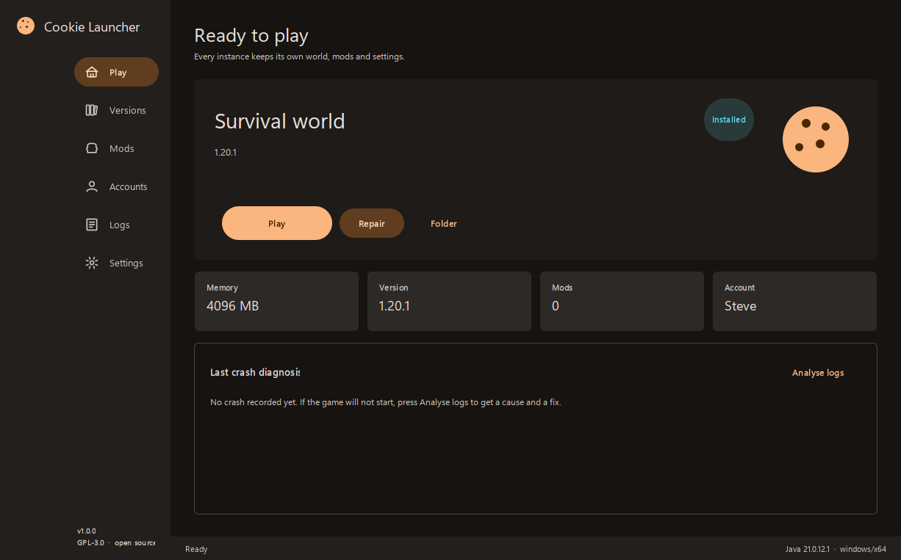

# Cookie Launcher

An open source Minecraft: Java Edition launcher with a Material Design 3 interface,
a dependency-free Java core, and downloads that survive real networks.

Cookie Launcher is not a fork. It was written from scratch after studying 22 existing
launchers, and it deliberately targets the three things none of them do well:
actionable crash diagnosis, full command-line parity, and keyboard-operable UI.



---

## What it is

- A launcher for **Minecraft: Java Edition** on Windows, macOS and Linux.
- **Zero runtime dependencies**: no Electron, no bundled Chromium, no JavaFX runtime
  download. One jar, one bundled JRE, one executable.
- **Material Design 3** throughout: tonal palettes generated in OKLCH, real state
  layers, ripples, and WCAG-verified contrast on every built-in theme.
- **Honest downloads**: every file carries its published SHA-1, every mirror is tried
  in a deterministic order, and an interrupted transfer resumes instead of restarting.

## What it is not

- Not a mod-pack store with bundled content, and it never installs mods you did not ask for.
- It has **no telemetry, no analytics, no ads, and no phone-home**. Nothing leaves your
  machine except requests to Mojang, your chosen mirror, and any server you play on.
- Not affiliated with Mojang, Microsoft, or any other launcher project.

---

## Features

### Versions and loaders

- Full Mojang version list (releases, snapshots, old alpha and beta), filtered and searchable.
- **Vanilla, Fabric, Quilt, Forge and NeoForge** installation. Fabric and Quilt are installed
  from their published profile metadata; Forge and NeoForge run their official installer
  headlessly, because reimplementing the binary-patching pipeline is a correctness risk.
- **Repair** verifies every file against its hash and re-fetches only what is broken.

### Downloads

- Parallel transfers over a shared HTTP/2 client, so a 400-file install pays the TLS
  handshake once per host rather than once per file.
- **Per-file integrity**: a file that fails its SHA-1 is deleted before the next mirror is
  tried, so a corrupt mirror can never poison an installation.
- **Resumable**: interrupted transfers continue from a `.part` file.
- **Mirror fallback**: official CDN first, then BMCLAPI for networks where the CDN is slow.
  Order is deterministic and visible in the log.
- Reinstalling an up-to-date version transfers **zero bytes**.

### Accounts

- **Offline** accounts with Mojang-compatible UUIDs, for singleplayer and LAN.
- **authlib-injector** support for third-party Yggdrasil servers, patched into the JVM.
- **Microsoft sign-in** is implemented (device-code flow) but ships dormant: no third-party
  client id is embedded. See [docs/AUTH.md](docs/AUTH.md) to supply your own.

### Diagnostics

This is the feature the research said nobody ships. Every launcher shows you a log;
Cookie Launcher reads it and tells you what to do.

- A rule table of 14 failure classes covers wrong Java version, out-of-memory, missing mod
  dependencies, duplicate mods, loader mismatch, graphics drivers, missing natives, corrupt
  assets, damaged worlds, port conflicts, rejected authentication, mixin conflicts, bad JVM
  flags and generic mod crashes.
- Each diagnosis carries the cause, the evidence line, and at least one concrete fix.
- Available from the Play page, the Logs page, and `cookie-launcher analyze <dir>`.

### Interface

- Six pages: Play, Versions, Mods, Accounts, Logs, Settings.
- Eight themes across four colour seeds, each in light and dark, all generated from
  Material 3 tonal palettes.
- Full keyboard traversal with a visible focus ring.

### Command line

Every GUI action has a headless equivalent:

```bash
cookie-launcher list                 # available and installed versions
cookie-launcher install 1.21.1       # vanilla
cookie-launcher install 1.21.1 --loader fabric
cookie-launcher launch 1.21.1 --wait # launch and follow the process
cookie-launcher repair 1.21.1        # verify every file
cookie-launcher java                 # detected Java runtimes
cookie-launcher analyze ./game-dir   # explain a crash
cookie-launcher doctor               # environment diagnostics
```

---

## Download

Grab the build for your platform from
[Releases](https://github.com/YuDu-Yaye/cookie-launcher/releases):

| Platform | File | Notes |
|---|---|---|
| Windows | `cookie-launcher-1.0.0-windows.zip` | Unzip and run `CookieLauncher.exe`. No Java needed. |
| macOS | `cookie-launcher-1.0.0-macos.zip` | Contains `Cookie Launcher.app`. |
| Linux | `cookie-launcher-1.0.0-linux.tar.gz` | Extract and run `bin/CookieLauncher`. |
| Any | `cookie-launcher.jar` | Requires Java 21. `java -jar cookie-launcher.jar`. |

Verify what you downloaded against `SHA256SUMS` in the same release.

### Portable mode

Create an empty file named `.portable` next to the executable. The launcher then keeps
everything in a `data/` folder beside itself instead of your application-data directory,
so the whole installation can live on a USB stick.

---

## First run

1. **Add an account.** Offline is enough for singleplayer; use authlib or Microsoft for
   online servers.
2. **Install a version.** The Versions page lists every Mojang release; pick one and choose
   a loader if you want mods.
3. **Play.** The launcher provisions a matching Java runtime automatically, so you do not
   need a JDK installed.

---

## Building from source

Requirements: **JDK 21**. Nothing else — there is no Gradle, Maven or npm step.

```bash
# Compile, run the tests, and build the jar
scripts/build.sh

# Also build a native app image with a bundled runtime
scripts/build.sh --package
```

On Windows:

```bat
scripts\build.bat
scripts\build.bat --package
```

Output lands in `build/dist/` (jar and checksums) and `build/app/` (native image).

> `jpackage` fails on very long paths on Windows. Build from a short directory such as
> `C:\build\cookie` if you hit `path exceeding 32000 characters`.

---

## Architecture

```
dev.cookielauncher
├── Main                  entry point, GUI vs CLI dispatch
├── cli/                  headless parity for every action
├── core/
│   ├── AppPaths          every on-disk location, portable-mode aware
│   ├── json/             zero-dependency JSON reader and writer
│   ├── net/              HTTP, parallel downloader, mirror policy, integrity
│   ├── util/             filesystem, hashing, zip, OS, formatting, progress
│   ├── log/              bounded in-memory history plus file append
│   └── config/           settings, instances, accounts
├── game/
│   ├── meta/             Mojang metadata: versions, libraries, rules, arguments
│   ├── install/          game, assets, natives, repair
│   ├── loader/           Fabric, Quilt, Forge, NeoForge
│   ├── java/             runtime discovery, validation, managed download
│   ├── launch/           command assembly and process control
│   ├── auth/             offline, Microsoft device code, authlib-injector
│   ├── mod/              mod metadata scanning and duplicate detection
│   └── diagnose/         crash rule engine
└── ui/                   theme, components, pages, window
```

Two rules keep the design honest:

1. `game/` never imports `ui/`. That is what makes the CLI a real first-class surface.
2. `core/` never imports `game/`. That is what keeps transport and storage reusable.

See [docs/ARCHITECTURE.md](docs/ARCHITECTURE.md) for the reasoning behind each boundary.

---

## Testing

91 unit tests covering the parts that silently break launchers:

| Suite | What it protects |
|---|---|
| `JsonTest` | Integer/decimal distinction, escapes, malformed input |
| `LibraryTest` | Maven coordinates, classifier paths, artifact fallback |
| `MirrorTest` | URL rewriting and deterministic candidate ordering |
| `LaunchArgsTest` | Placeholder substitution, rule gating, classpath order, quick play |
| `CrashAnalyzerTest` | Every rule fires on its own signature; clean logs stay silent |
| `ThemeTest` | M3 tone mapping and WCAG contrast across all eight themes |
| `AccountTest` | Offline UUIDs and token hygiene |

```bash
scripts/build.sh   # runs the suite before packaging
```

Two live checks are included as scripts rather than unit tests because they need network
access and a real game install: `scripts/smoke/FullInstall.java` and `scripts/smoke/RealLaunch.java`.

---

## Roadmap

- **1.1**: Modrinth catalogue browsing with dependency resolution; CurseForge if its terms
  allow keyless third-party clients.
- **1.2**: Microsoft sign-in enabled by default once a community client id exists.
- **Later**: mod conflict detection across loaders, instance export/import, world backups.

---

## Contributing

Contributions are welcome. Start with [docs/CONTRIBUTING.md](docs/CONTRIBUTING.md).

- Code, comments, UI strings and documentation are **English only**.
- Every behaviour change needs a test. The suite runs in under a second.
- Crash rules are data: adding a failure class means adding a `Rule` entry and a fixture,
  not new engine code.

---

## License

[GPL-3.0-only](LICENSE). You may fork, modify and redistribute under the same terms.

## Acknowledgements

Cookie Launcher learned from the projects that came before it, particularly:

- **MultiMC** and **Prism Launcher** — the instance-as-directory model that the whole
  ecosystem converged on.
- **HMCL** — the download-provider-with-fallback idea, and proof that a Java launcher can
  serve every platform.
- **PCL2** and **PCL2 Community Edition** — showing that cold-start speed and China-network
  tuning matter more to users than architecture diagrams.
- **XMCL** and **Modrinth App** — resumable transfers and catalogue-first design.
- **Pandora Launcher** — proving a launcher can take security seriously.

Full analysis, including what each project does badly, is in [docs/RESEARCH.md](docs/RESEARCH.md).
